<!--
  Profile README for github.com/Maggiee18
  Design assets live in /assets (SVGs with embedded fonts, light + dark variants).
  Snake + stats cards are generated by .github/workflows/snake.yml and published to the `output` branch.
  TODO: in "Let's Connect", replace RESUME_URL with a public link to your resume
  (Google Drive "anyone with the link", or a PDF committed to this repo, e.g. assets/resume.pdf).
-->

  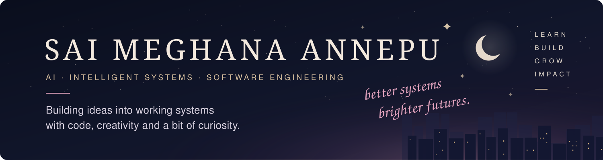

  <picture>
    <source media="(prefers-color-scheme: dark)" srcset="assets/cards/intro-dark.svg" />
    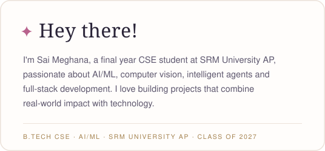
  </picture>
  <picture>
    <source media="(prefers-color-scheme: dark)" srcset="assets/cards/code-dark.svg" />
    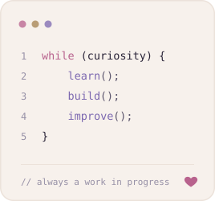
  </picture>

 

## Let's Connect

<a href="https://linkedin.com/in/sai-meghana-annepu"><picture><source media="(prefers-color-scheme: dark)" srcset="assets/connect/linkedin-dark.svg" /></picture></a>&nbsp;
<a href="https://x.com/SaiMeghana_18"><picture><source media="(prefers-color-scheme: dark)" srcset="assets/connect/x-dark.svg" /></picture></a>&nbsp;
<a href="https://github.com/Maggiee18"><picture><source media="(prefers-color-scheme: dark)" srcset="assets/connect/github-dark.svg" /></picture></a>&nbsp;
<a href="mailto:annepu.saimeghana@gmail.com"><picture><source media="(prefers-color-scheme: dark)" srcset="assets/connect/email-dark.svg" /></picture></a>&nbsp;
<a href="assets/SaiMeghanaAnnepu__Resume.pdf"><picture><source media="(prefers-color-scheme: dark)" srcset="assets/connect/resume-dark.svg" /></picture></a>

 

## Tech Stack

<i>Technologies I work with and explore</i>

<b>LANGUAGES</b> 
<picture><source media="(prefers-color-scheme: dark)" srcset="assets/stack/dark/python.svg" /></picture>
<picture><source media="(prefers-color-scheme: dark)" srcset="assets/stack/dark/java.svg" /></picture>
<picture><source media="(prefers-color-scheme: dark)" srcset="assets/stack/dark/c.svg" /></picture>
<picture><source media="(prefers-color-scheme: dark)" srcset="assets/stack/dark/cpp.svg" /></picture>
<picture><source media="(prefers-color-scheme: dark)" srcset="assets/stack/dark/javascript.svg" /></picture>
<picture><source media="(prefers-color-scheme: dark)" srcset="assets/stack/dark/typescript.svg" /></picture>
<picture><source media="(prefers-color-scheme: dark)" srcset="assets/stack/dark/sql.svg" /></picture>

<b>AI/ML</b> 
<picture><source media="(prefers-color-scheme: dark)" srcset="assets/stack/dark/pytorch.svg" /></picture>
<picture><source media="(prefers-color-scheme: dark)" srcset="assets/stack/dark/tensorflow.svg" /></picture>
<picture><source media="(prefers-color-scheme: dark)" srcset="assets/stack/dark/opencv.svg" /></picture>
<picture><source media="(prefers-color-scheme: dark)" srcset="assets/stack/dark/scikit-learn.svg" /></picture>
<picture><source media="(prefers-color-scheme: dark)" srcset="assets/stack/dark/langchain.svg" /></picture>
<picture><source media="(prefers-color-scheme: dark)" srcset="assets/stack/dark/gemini.svg" /></picture>
<picture><source media="(prefers-color-scheme: dark)" srcset="assets/stack/dark/rag.svg" /></picture>

<b>FRAMEWORKS</b> 
<picture><source media="(prefers-color-scheme: dark)" srcset="assets/stack/dark/flask.svg" /></picture>
<picture><source media="(prefers-color-scheme: dark)" srcset="assets/stack/dark/fastapi.svg" /></picture>
<picture><source media="(prefers-color-scheme: dark)" srcset="assets/stack/dark/spring-boot.svg" /></picture>
<picture><source media="(prefers-color-scheme: dark)" srcset="assets/stack/dark/react.svg" /></picture>
<picture><source media="(prefers-color-scheme: dark)" srcset="assets/stack/dark/nodejs.svg" /></picture>
<picture><source media="(prefers-color-scheme: dark)" srcset="assets/stack/dark/tailwind.svg" /></picture>

<b>DATABASES</b> 
<picture><source media="(prefers-color-scheme: dark)" srcset="assets/stack/dark/mysql.svg" /></picture>
<picture><source media="(prefers-color-scheme: dark)" srcset="assets/stack/dark/postgresql.svg" /></picture>
<picture><source media="(prefers-color-scheme: dark)" srcset="assets/stack/dark/mongodb.svg" /></picture>
<picture><source media="(prefers-color-scheme: dark)" srcset="assets/stack/dark/firebase.svg" /></picture>

<b>TOOLS &amp; CLOUD</b> 
<picture><source media="(prefers-color-scheme: dark)" srcset="assets/stack/dark/git.svg" /></picture>
<picture><source media="(prefers-color-scheme: dark)" srcset="assets/stack/dark/github.svg" /></picture>
<picture><source media="(prefers-color-scheme: dark)" srcset="assets/stack/dark/docker.svg" /></picture>
<picture><source media="(prefers-color-scheme: dark)" srcset="assets/stack/dark/aws.svg" /></picture>
<picture><source media="(prefers-color-scheme: dark)" srcset="assets/stack/dark/render.svg" /></picture>
<picture><source media="(prefers-color-scheme: dark)" srcset="assets/stack/dark/vercel.svg" /></picture>
<picture><source media="(prefers-color-scheme: dark)" srcset="assets/stack/dark/postman.svg" /></picture>

 

## Pinned Projects

<a href="https://github.com/Maggiee18/crowd-risk-analysis"><picture><source media="(prefers-color-scheme: dark)" srcset="assets/projects/crowd-risk-analysis-dark.svg" />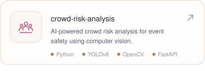</picture></a>
<a href="https://github.com/Maggiee18/hhgoa-fraud-agent"><picture><source media="(prefers-color-scheme: dark)" srcset="assets/projects/hhgoa-fraud-agent-dark.svg" />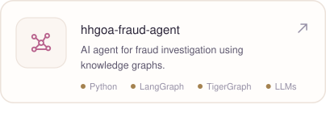</picture></a>
<a href="https://github.com/Maggiee18/Kavach-AI"><picture><source media="(prefers-color-scheme: dark)" srcset="assets/projects/kavach-ai-dark.svg" />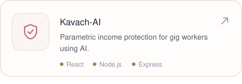</picture></a>
<a href="https://github.com/Maggiee18/lenny-growth-assistant"><picture><source media="(prefers-color-scheme: dark)" srcset="assets/projects/lenny-growth-assistant-dark.svg" />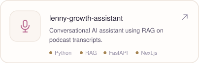</picture></a>
<a href="https://github.com/Maggiee18/SecureBank"><picture><source media="(prefers-color-scheme: dark)" srcset="assets/projects/securebank-dark.svg" />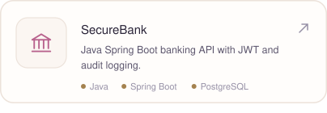</picture></a>
<a href="https://github.com/Maggiee18/gem-cascade"><picture><source media="(prefers-color-scheme: dark)" srcset="assets/projects/gem-cascade-dark.svg" />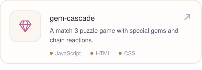</picture></a>

<a href="https://github.com/Maggiee18?tab=repositories">View all repositories →</a>

 

## GitHub Stats

<a href="https://github.com/Maggiee18"><picture><source media="(prefers-color-scheme: dark)" srcset="https://raw.githubusercontent.com/Maggiee18/Maggiee18/output/stats-dark.svg" /></picture></a>
<a href="https://github.com/Maggiee18?tab=repositories"><picture><source media="(prefers-color-scheme: dark)" srcset="https://raw.githubusercontent.com/Maggiee18/Maggiee18/output/top-langs-dark.svg" /></picture></a>

<a href="https://github.com/Maggiee18"><picture><source media="(prefers-color-scheme: dark)" srcset="https://streak-stats.demolab.com/?user=Maggiee18&background=11162A&border=242B45&stroke=242B45&ring=EBA9C4&fire=D9C1A0&currStreakNum=F3E9DE&sideNums=F3E9DE&currStreakLabel=EBA9C4&sideLabels=B8B2C6&dates=7E7A92&border_radius=16" /></picture></a>

<a href="https://github.com/Maggiee18">View more →</a>

 

## Contribution Garden

*A little progress, every day.*

<picture>
  <source
    media="(prefers-color-scheme: dark)"
    srcset="https://raw.githubusercontent.com/Maggiee18/Maggiee18/output/github-snake-dark.svg"
  />
  <source
    media="(prefers-color-scheme: light)"
    srcset="https://raw.githubusercontent.com/Maggiee18/Maggiee18/output/github-snake.svg"
  />
  
</picture>

  

<picture>
  <source media="(prefers-color-scheme: dark)" srcset="assets/cards/quote-dark.svg" />
  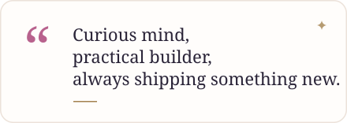
</picture>

  

<picture>
  <source media="(prefers-color-scheme: dark)" srcset="assets/cards/footer-dark.svg" />
  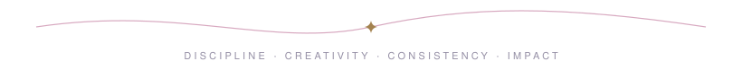
</picture>

Turning ideas into working systems. ✨

